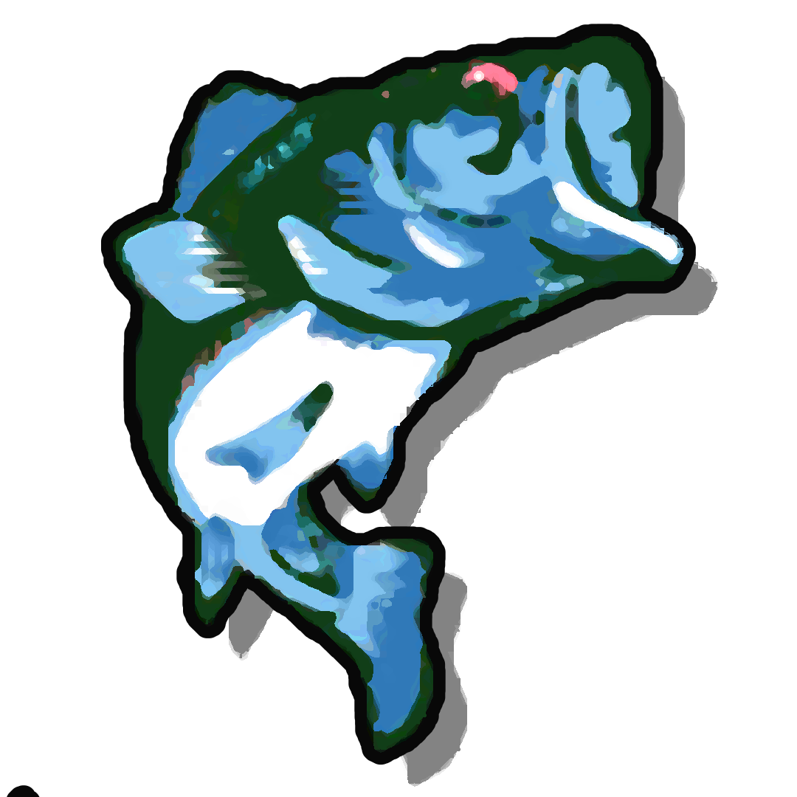

#  Our Minature Shell Project


> A Miniture shell project where you create a fairly simple Unix Shell. This shell has parsing for commands, execution, piping, redirection to name a few. The goal for this project is to essentially understand how shells works. It's an introduction to systems programming & CLI


## INSTRUCTIONS FOR COMPILATION:
```
make
make re - Remake Compilation
make clean - Clean up object files
make fclean - Clean up object files & program
run ./minishell
```

## Available Options
The shell runs executables from an absolute, relative or environment path. `[/bin/ls]` or `[ls]`. You can also run commands with `''` or `""` which works the same like it does in Bash.

You can also separate commands with `;`, As well as redirection support with `<` `>` `|` `>>`

Environment Variables are handled such as `$HOME`, `$?` is supported as well. You can also access environment variables with `env` & add `export` to add an environment variable.

`CTRL + C` `CTRL + D` `CTRL + \` are supported as well, making interrupting, quitting and throwing an EOF respectively.

A fair few `"built-in"` functions have also been implemented, specifically `echo` `pwd` `cd` `env` `export` `unset` & `exit`


